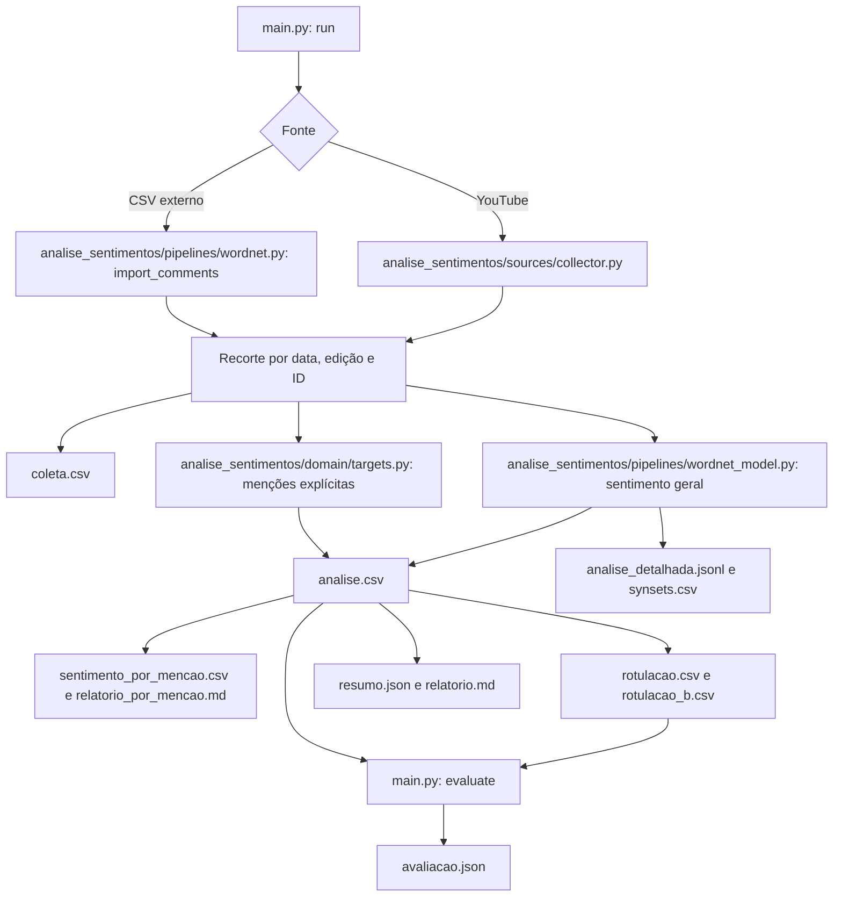

# Fluxo do projeto, do zero

Este documento descreve o funcionamento **atual do código**. O objetivo é
analisar comentários desde o início anunciado do debate presidencial da Band,
em 16/10/2022, até três horas após a publicação do vídeo. Comentários feitos
anos depois não entram, mesmo quando falam do debate. O relatório distingue
reação durante a transmissão de repercussão posterior.

## 1. Preparar o ambiente

Abra o PowerShell na raiz do projeto e execute:

```powershell
py -m venv .venv
.\.venv\Scripts\python.exe -m pip install -r requirements.txt
.\.venv\Scripts\python.exe -m nltk.downloader stopwords wordnet sentiwordnet omw-2.0
```

Copie `.env.example` para `.env` e preencha `YOUTUBE_API_KEY` com uma chave
da YouTube Data API v3. `analise_sentimentos/config/settings.py` lê esse arquivo. O modelo
`pt_core_news_lg` está declarado em `requirements.txt`; o pacote é carregado
por `analise_sentimentos/pipelines/wordnet_model.py`. A chave não deve entrar no controle de versão.

## 2. Escolher a fonte e executar

O comando padrão consulta os comentários do vídeo `iYVk1CeIs60`:

```powershell
.\.venv\Scripts\python.exe main.py
```

`main.py` também aceita `run` explicitamente. Para analisar um CSV de chat
ou de comentários obtido por outra fonte verificável, use
`--input-csv caminho\arquivo.csv`. O CSV precisa de `comment_id`, `text` e
`published_at` em ISO 8601 com fuso. `updated_at`, `like_count` e
`reply_count` são opcionais. Essa alternativa passa pelo mesmo filtro temporal,
mas o programa marca sua cobertura como não verificada. O código não baixa
automaticamente mensagens antigas do chat ao vivo.

## 3. Aplicar o recorte temporal

O intervalo padrão vai de **16/10/2022 20:00:00 a 17/10/2022 01:06:39,
horário de Brasília (UTC−03)**. Em UTC, vai de `2022-10-16T23:00:00Z` a
`2022-10-17T04:06:39Z`, incluindo as duas extremidades. O início usa o horário
anunciado para o debate. O fim é calculado como `snippet.publishedAt` do vídeo
mais três horas. A API registrou a publicação às 22:06:39 de 16/10/2022.
No modo CSV, o programa usa esse horário de publicação já registrado em
`analise_sentimentos/domain/periods.py`, sem exigir nova chamada à API. `--start` e `--end`
permitem informar outro recorte, com datas ISO 8601 que incluam fuso.

Em `analise_sentimentos/sources/collector.py`, o programa busca os comentários principais via
`commentThreads.list`, em ordem temporal, página por página. Para cada item:

1. elimina IDs duplicados;
2. descarta `publishedAt` posterior ao fim ou anterior ao início;
3. descarta texto cujo `updatedAt` seja posterior ao fim, pois o texto atual
   pode não ser o que existia no período estudado;
4. marca cada comentário como `durante_debate`,
   `entre_debate_e_publicacao` ou `apos_publicacao`, usando o fim da
   transmissão e a publicação do vídeo;
5. guarda texto, ID, datas, período, curtidas e contagem de respostas.

A paginação termina quando alcança comentários anteriores ao início ou acaba a
lista. `--max-pages 2`, por exemplo, serve para diagnóstico: o resultado fica
marcado como **coleta incompleta**. Uma falha da API interrompe o comando; não
é emitido relatório parcial como se fosse uma coleta concluída.

`analise_sentimentos/pipelines/wordnet.py` usa o mesmo recorte ao importar um CSV externo. O
resultado dessa importação não confirma que o arquivo contém todas as mensagens
do intervalo.

## 4. Analisar os textos elegíveis

Para cada comentário mantido, `analise_sentimentos/pipelines/wordnet.py` chama dois componentes:

- `analise_sentimentos/pipelines/wordnet_model.py`: `pt_core_news_lg` fornece tokens, lemas e classes
  gramaticais; WordNet/SentiWordNet fornece escores léxicos. O código tira a
  média dos sentidos encontrados, trata negação local e compara o total positivo
  com o negativo. A diferença relativa de até 10% vira `neutral`; quando não
  há escore, o rótulo é `insufficient_evidence`. Isso mede **sentimento geral do
  comentário**, como linha de base heurística.
- `analise_sentimentos/domain/targets.py`: expressões regulares detectam menções explícitas a
  Lula e Bolsonaro, incluindo termos previstos no código e números eleitorais
  isolados. Uma mensagem pode mencionar ambos ou nenhum. Menção não significa
  apoio ou oposição. `stance_lula` e `stance_bolsonaro` ficam
  `nao_avaliada`: não existe classificador automático de posição validado.

O fluxo é:



## 5. Ler os resultados

Os arquivos são gravados em `output/` na raiz, mesmo se `main.py` for iniciado
de outra pasta. `--output` permite escolher outra pasta.

| Arquivo | Como usar |
| --- | --- |
| `coleta.csv` | Conferir comentários, metadados e período dos itens elegíveis. |
| `analise.csv` | Inspecionar período, sentimento, escores, menções e posição não avaliada. |
| `analise_detalhada.jsonl` | Ler cada comentário com os termos considerados, seus synsets e escores. |
| `synsets.csv` | Filtrar em planilha cada termo e synset pelo `comment_id`. |
| `sentimento_por_mencao.csv` | Contar sentimento geral em comentários que mencionam cada candidato, com grupos exclusivos para evitar dupla contagem. |
| `relatorio_por_mencao.md` | Ler essas contagens e a distinção entre menção e apoio. |
| `resumo.json` | Ver fonte, janela, cobertura, exclusões e contagens por período. |
| `relatorio.md` | Ler o resumo e as limitações em linguagem de relatório. |
| `rotulacao.csv` | Preencher os rótulos humanos da amostra principal. |
| `rotulacao_b.csv` | Dar a uma segunda pessoa a subamostra fixa de 25%, de forma independente. |

A amostra tem semente fixa e tenta equilibrar os tipos de menção: Lula, Bolsonaro,
ambos e nenhum. Por isso, **as proporções da amostra não estimam as proporções
de todos os comentários**. Arquivos de rotulagem que já contenham linhas são
preservados nas próximas execuções. Os demais resultados são gerados novamente.
Cada execução de `run` marca `avaliacao.json` como pendente, pois métricas de um
recorte anterior não valem automaticamente para a nova coleta.

Após a coleta, o programa mostra o avanço da análise de sentimento a cada 500
comentários. Se `analise.csv` já existir e você só precisar dos detalhes, rode
`.\.venv\Scripts\python.exe main.py details`; isso recalcula os escores locais
e confere se coincidem com o CSV, sem usar a API. Para ver um comentário em
formato legível, rode
`.\.venv\Scripts\python.exe scripts\inspecionar_analise.py --numero 1`
ou passe `--id` com um `comment_id` de `analise.csv`.

No arquivo `synsets.csv`, os escores do synset são os valores lexicais antes
da negação. Os escores do termo são a média dos synsets considerados, com
positivo e negativo trocados quando a negação local se aplica. A soma dos
termos gera o escore do comentário. O código usa todos os sentidos encontrados
com escore não totalmente objetivo; **não escolhe o sentido correto pelo
contexto**. Palavras ignoradas por classe gramatical ou stopword não aparecem
nesses detalhes. Uma contribuição de termo se repete nas linhas de seus synsets
em `synsets.csv`; para reproduzir o total, some cada termo apenas uma vez.

`main.py candidates` recria a tabela por menção a partir de `analise.csv`, sem
consultar a API nem refazer a análise lexical. A tabela inclui linhas para
cada candidato mencionado, que podem se sobrepor, e quatro grupos exclusivos:
somente Lula, somente Bolsonaro, ambos e nenhum. Ela **não informa quantos
comentários são favoráveis ou contrários a cada candidato**: a classificação
atual mede o sentimento do texto inteiro.

## 6. Fazer a validação humana

Se houver mensagens elegíveis, preencha `sentimento_geral`, `posicao_lula`,
`posicao_bolsonaro` e `assunto_principal` em `output/rotulacao.csv`, sem alterar
`comment_id`. Uma segunda pessoa preenche `rotulacao_b.csv` sem consultar a
primeira. Os valores aceitos estão no [README](../README.md#rotulagem-e-avaliação).

Depois execute:

```powershell
.\.venv\Scripts\python.exe main.py evaluate
```

`output/avaliacao.json` contém métricas de sentimento geral e de detecção de
menção para os itens rotulados: matriz de confusão, precisão, revocação e F1.
Também registra concordância observada e kappa de Cohen entre as duas pessoas,
além das contagens humanas de posição por candidato. Não há métrica de posição
automática enquanto não houver um classificador dessa tarefa.

## 7. Interpretar o resultado atual e suas limitações

Na coleta completa do recorte ampliado, `output/resumo.json` registrou
**332 páginas, 33.153 comentários principais examinados e 15.088 elegíveis**.
Destes, **0** foram publicados durante o debate, **2.341** entre o fim da
transmissão (21:52:18) e a publicação do vídeo (22:06:39), e **12.747** desde
a publicação até três horas depois. Outros 60 comentários publicados dentro
da janela foram excluídos porque seu texto havia sido editado depois do fim.
A amostra para rotulagem tem 500 itens, e a segunda pessoa recebe 125.

Há comentários datados antes de `snippet.publishedAt` do vídeo. Assim, esse
campo é um marco operacional da API para calcular as três horas; ele não
determina quando a página da transmissão começou a aceitar comentários.

Esses números descrevem comentários principais acessíveis pela API na data
da coleta. Os publicados após o fim não medem a reação **durante** o debate.
Os totais automáticos de sentimento são exploratórios até a validação humana.
Para estudar mensagens feitas ao vivo, seria necessário obter um arquivo
histórico de chat com origem, timestamps e cobertura verificáveis.

O recorte tem outras limitações normais para um TCC: o horário de início é o
anunciado, os comentários disponíveis hoje não incluem os removidos, a API de
comentários principais não é a de chat ao vivo, e o método léxico pode errar
com ironia, gírias e contexto. O modelo LG faz análise linguística, não
classificação política. Essas condições devem acompanhar qualquer conclusão.

## Arquivos que não participam desse fluxo

`scripts/` contém ferramentas para extrair texto do PDF de referência e gerar
slides. Elas são opcionais e usam, respectivamente, `PyPDF2` e `python-pptx`,
que não fazem parte das dependências da análise principal. `docs/experimentos/`
guarda protótipos anteriores; executá-los pode disparar downloads do NLTK e
criar arquivos auxiliares. `docs/tcc/` guarda o manuscrito e um PDF do TCC;
`docs/referencias/` e `docs/apresentacoes/` guardam material de apoio. O
manuscrito LaTeX já faz referência a imagens e bibliografia ausentes nesta
pasta, então a mudança de lugar não o torna compilável por si só.
